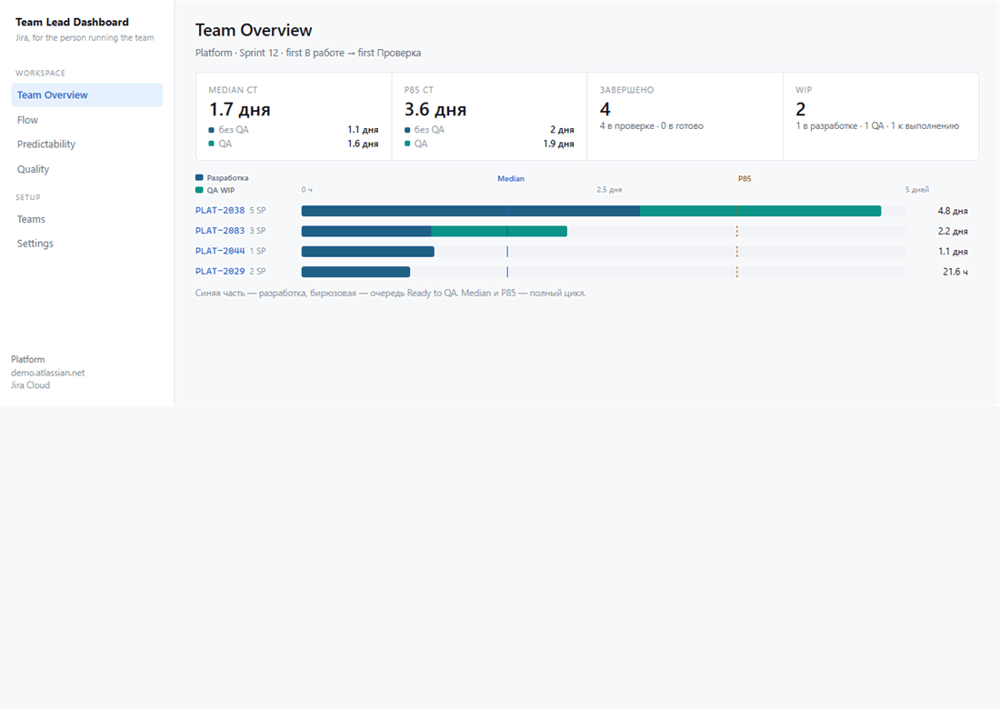

# Team Lead Dashboard

A local dashboard for the person running a Jira team.

Sprint health, flow, predictability and quality, from the boards you already have. The API token is encrypted in your database and is only sent to your Jira site.

No account. No hosted service. Fork it, point it at your board, change the status names.



The board in the picture is fictional.

## Quick start

Node.js 22 or newer.

```bash
git clone https://github.com/LedinRoman/teamlead-dashboard.git
cd teamlead-dashboard
cp .env.example .env
npm install
npm run dev
```

Open http://localhost:3000.

1. **Settings.** Paste the Jira URL and a token. Cloud wants the account email plus an API token. Server / Data Center wants a personal access token and an empty email. Read-only access is enough: this app never writes to Jira.
2. **Teams.** Pick the boards and the people on them.
3. **Team Overview.** The active sprint, side by side if you have more than one team.

Local data is a SQLite file under `data/`. It is gitignored.

## What each screen answers

| Screen | Question |
| --- | --- |
| Team Overview | Is this sprint on fire, and where? |
| Flow | How long does work sit in each stage, and what is aging? |
| Predictability | Did the sprint land, and what changed scope? |
| Quality | What came back from review or test? |
| Teams | Which boards and people count as this team? |
| Settings | Jira URL, token, stale thresholds, flow stages |

`/formulas` writes down what each number reads, and what it cannot see.

## Make the numbers match your board

Jira's own "Done" category is often later than a team means. Settings is where *done*, flow stages and the QA filter live. Every screen uses those same rules.

The default stage names include a few Russian statuses (`К выполнению`, `Проверка`) from the board this started on. Replace them in Settings → Flow stages. Nothing else is hardcoded to one company.

## Docker

Postgres, so the token and teams survive a container restart.

```bash
docker compose up --build
```

The UI is on http://localhost:3000. Data lives in two Docker volumes: Postgres, and the app data directory that holds the encryption key.

Change `DB_PASSWORD` before you expose this past your own machine. The compose file binds to `127.0.0.1`.

## License

[MIT](LICENSE). Fork it.
